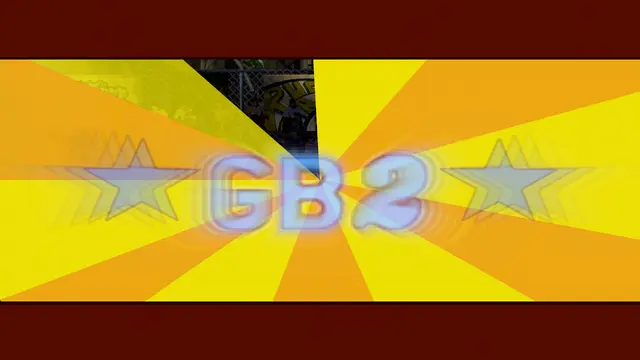
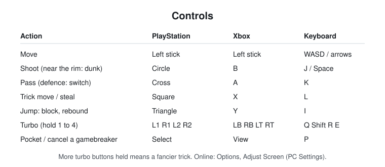
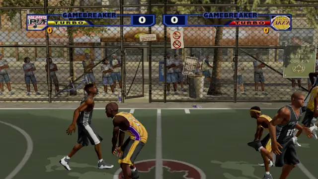
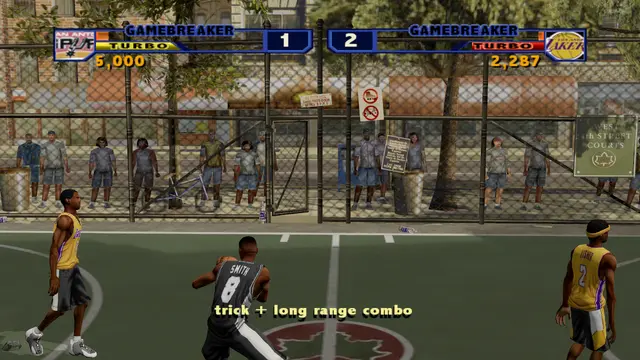
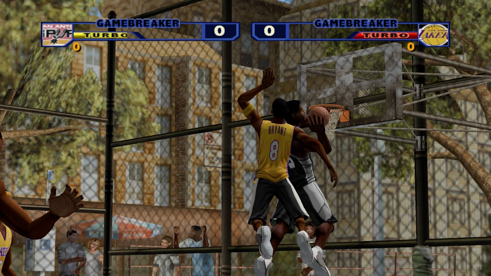
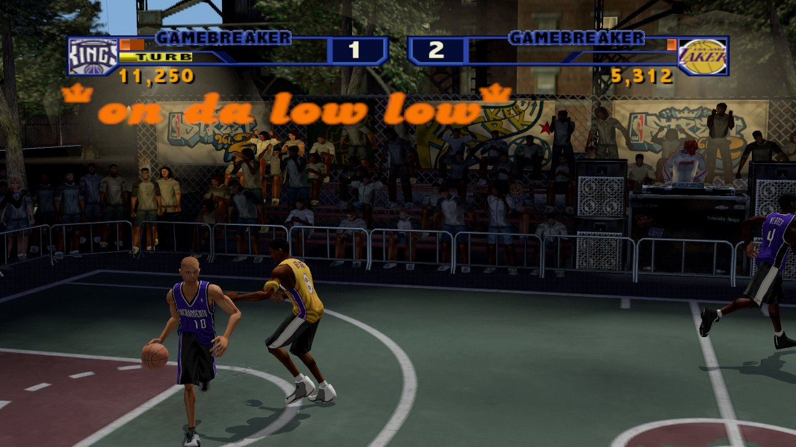
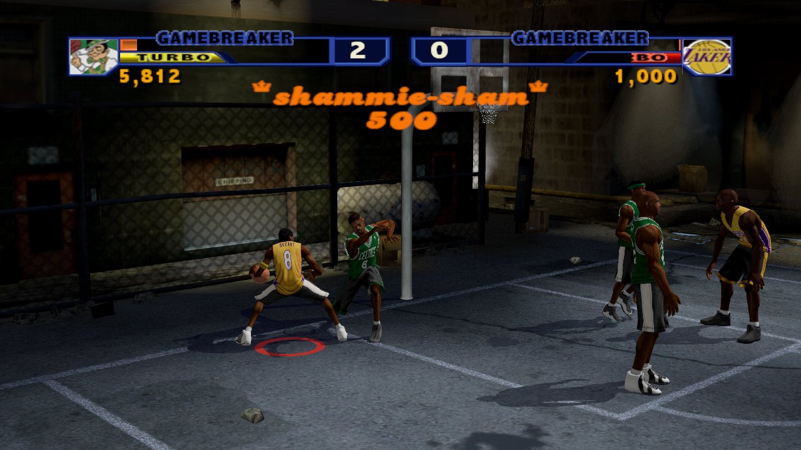
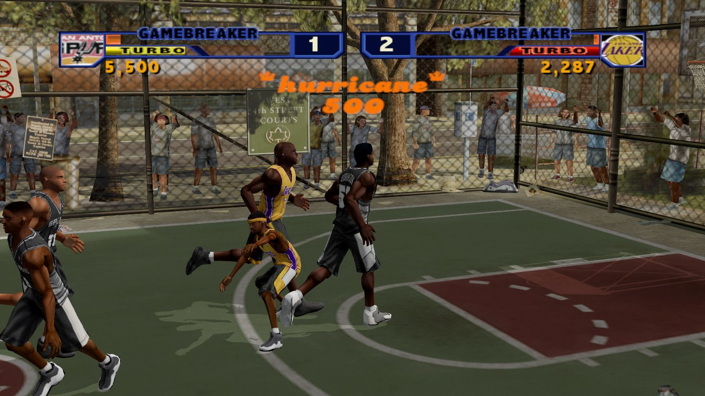
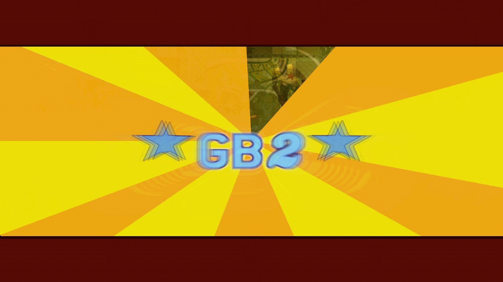
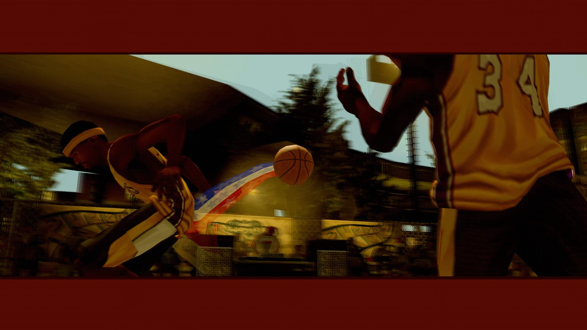

# Streetball Revival

**A from-scratch PC rebuild of a classic 2003 PlayStation 2 three-on-three
streetball game, with the online play it never had.** Up to six people, three
a side, over the internet or a home network.

> **Public beta.** Most of the game plays like the original; some things are
> still being matched, and you may hit bugs. See [Beta status](#beta-status).
> **Online play is a work in progress and needs testing**: please try it
> with friends and tell us how it goes.
>
> **Feedback welcome.** Join the [Discord](https://discord.com/invite/htu5pdxPQz) to report bugs, share
> what feels different from the original, or find people to play online.
>
> **Unofficial fan project.** Not affiliated with or endorsed by the original
> game's makers or its league. It contains no game data: it plays from **your
> own disc image**. See [LEGAL.md](LEGAL.md).
>
> **Made with the help of AI.** Much of this rebuild was written with the help
> of a large language model (LLM), so **features may be missing** or behave
> differently from the original. See [AI disclosure](#ai-disclosure).

<p align="center">
  
</p>

## Get started

1. **Make a disc image of your own copy** of the game: the USA PlayStation 2
   release, serial **SLUS-20651** (the full title is in [LEGAL.md](LEGAL.md)).
   Save it as a `.iso` file anywhere on your PC.
2. **Download** the latest zip from this repository's **Releases** page and
   unzip it into a folder of its own.
3. **Run `StreetballRevival.exe`**, press **Browse** and pick your `.iso` (or
   drop it on the window). The launcher checks it is the right release and
   remembers it.
4. Press **Play**.

If Windows says *"Windows protected your PC"*, click **More info**, then
**Run anyway** (this free project's files aren't signed). `START HERE.txt` in
the zip covers controls, settings and troubleshooting.

The launcher keeps the disc's location in `Documents\Streetball Revival`,
next to your save. Change it any time with **Change disc**.

A controller is optional: PlayStation, Xbox and most SDL-known pads work and
can be plugged in at any time, and the keyboard works too.

<p align="center">
  
</p>

## What you can play

- **Pick Up Game**: any two teams, any court, with every My Rules option
  (scoring, play-to, shot clock, Dunks Only, Trick Point Challenge,
  Gamebreaker Wins and more). Up to four people on one PC.
- **Be A Legend**: create your baller and take them from the playgrounds to
  legend status.
- **League Challenge**, **Street School** (lessons that teach the moves one at
  a time), the **Rewards** shop, **Create A Baller** and **Create Team**.
- **Online**: 1 vs 1, and the new 3 vs 3.

Tricks: hold turbo buttons while pressing the trick button; the more turbo
buttons held, the fancier the move. Tricks fill your **gamebreaker** meter;
when it is full, shoot for a gamebreaker.

## Screenshots

Every picture below is the rebuild running real matches, captured straight
from the game.

<p align="center">
  
  
</p>

| | |
|:-:|:-:|
|  |  |
|  |  |
|  |  |

## Playing online

> **Work in progress.** Online play is new and still needs testing. Expect
> rough edges: dropped connections, desyncs or lobby trouble. If you hit
> one, tell us on the [Discord](https://discord.com/invite/htu5pdxPQz) or in an issue, with what you were
> doing and whether you hosted or joined.

On the Main Menu press **Select** (**P** on the keyboard) for **Online**.

- **Host 1 vs 1** or **Host 3 vs 3**. The lobby shows a **join code** like
  `7QK3-M2X`; send it to your friends. The computer plays any seat nobody
  takes.
- Friends on the same network see the match as **Join On Network**; anyone
  else picks **Join With Code**.
- Everyone needs their own disc image of the same release. Only button
  presses (and a check that everyone's disc matches) cross the network.

The host's game asks the router to open UDP port 7375 (UPnP). If friends
can't connect, [docs/PLAYING.md](docs/PLAYING.md) walks through port
forwarding and the VPN fallback.

## Beta status

The goal is a 1:1 rebuild: every rule, animation, screen and sound as the
original does it. Each behaviour is checked against the original running in
an emulator (recorded matches, the front end's screens, Street School's
lessons) and against its program code.

The [parity scorecard](docs/PARITY_SCORECARD.md) tracks 211 behaviours today:
**168 matched**, **24 known differences** and **19 not yet tested**. That is a
selected list, not a whole-game percentage. The biggest open areas:

- the computer's team play (where defenders stand, how often they block and
  guard the rim), which is close but not yet identical;
- pixel-exact rendering (lighting, shadows, the crowd, the nets);
- the gamebreaker and celebration cameras, and some results-screen details.

## AI disclosure

This project was built with the help of a large language model (LLM):
Anthropic's Claude wrote and tested much of the code and the research notes,
working from the original game's program and recorded matches, with a person
directing the work and playing every build. That makes it possible to rebuild
a whole game in detail, but it also means:

- **some features may be missing**, unfinished or work differently from the
  original, even where the docs describe them;
- bugs can hide in code no person has read line by line.

If something is missing or feels wrong, please say so on the
[Discord](https://discord.com/invite/htu5pdxPQz) or in an issue: reports
against the original are the best way it gets fixed.

## Feedback

Found a bug, or something that plays differently from the original? Tell
us on the [Discord](https://discord.com/invite/htu5pdxPQz) or open an issue with what you did, what you
expected and what happened. Feedback on online matches is especially
welcome while that mode is being tested. Please don't attach disc images
or game files.

## Build from source

Install [Rust](https://rustup.rs), then from this folder:

```sh
cargo run -p street-launcher                 # the launcher (finds street-game beside it)
cargo run -p street-game -- --iso path/to/your-disc.iso
cargo test                                   # unit tests; set STREET_ISO for the disc checks
```

`street-game` also finds a disc image in its own folder or the folders above,
or through the `STREET_ISO` environment variable. Useful options:
`--demo` (the computer plays both sides), `--speed <x>`,
`--original-load-times`, `--screenshot out.png --at <secs>`.

Online from the command line:

```sh
cargo run -p street-game -- --host                       # host and play
cargo run -p street-game -- --join 192.168.1.20          # join (port 7375 by default)
cargo run -p street-server -- --vol2 path/to/your-disc.iso   # a headless server (it needs a disc)
```

The first launch shows only sky for a few seconds while shaders compile;
later launches reuse the cache.

## Layout

```
crates/street-launcher  the launcher: find your disc, then play
crates/street-game      the game: menus, matches, modes, online
crates/street-sim       the simulation: fixed 60 Hz, deterministic, no rendering
crates/street-render    rendering: courts, skinned players, animation
crates/street-net       online play: protocol, rollback sessions, client and server
crates/street-server    the headless match server
crates/street-assets    readers for the disc's formats
crates/street-audio     the disc's audio: streams, banks, codecs, music
crates/street-video     the disc's movies
crates/street-viewer    a court, player and animation viewer
crates/street-export    exports your own disc's characters and art to open formats
docs/                   formats, traces, the parity scorecard and how to play online
tools/                  research and capture helpers
```

## Contributing

Issues and pull requests are welcome; read [CONTRIBUTING.md](CONTRIBUTING.md)
first. The one hard rule: **no game data, ever** (no disc images, extracted
files, art, audio or saves). `python tools/publish_check.py` checks for it.

## Legal

Streetball Revival is an unofficial fan project, not affiliated with or
endorsed by any rights holder of the original game. Its own code is under
the [MIT licence](LICENSE); trademarks and the full notice are in
[LEGAL.md](LEGAL.md).

Made by **Vj** ([@luckvj](https://github.com/luckvj)).
